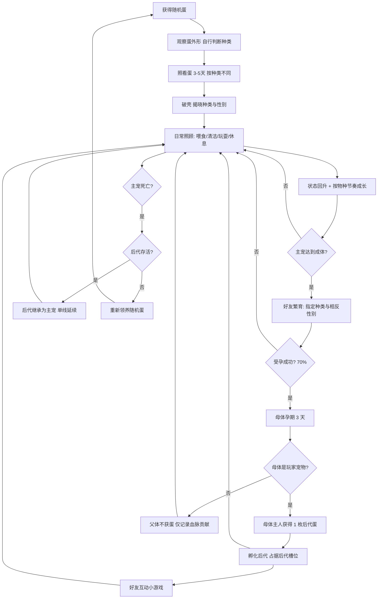

# CyberPet 游戏设计文档（GDD）

> **版本**：v0.4（按 2026-11-26 第三轮评审意见改写）　**日期**：2026-11-26　**状态**：待评审
> **项目**：CyberPet — 拟真史前动物主题微信小游戏
> **玩法参考**：拓麻歌子养成核心 + 数码暴龙机成长分支 + QQ 宠物繁育社交
> **阶段**：项目阶段一「完成小游戏项目的设计内容」
>
> **v0.4 主要变更**：① **只有母体（雌性）产蛋并获得后代**，父体（雄性）不获得后代但**交配次数不设限**；② **取消多宠饲养**，玩家同一时间只能豢养**一只主养宠物 + 它的一个后代**，死亡处理不再有多宠场景；③ **孵化时间按种类 3–5 天差异化**，寿命与各成长阶段时长也按种类不同。

---

## 1. 产品概述

### 1.1 一句话定位

从一枚只能靠外形辨认的恐龙蛋开始，花 3–5 天等待它孵化，用各自不同的寿命（约 80–110 天）照顾一只史前生物，与好友繁育延续血脉——玩家始终只养一只主宠和它的一个后代。

### 1.2 玩法参考与取舍

| 参考原型 | 借鉴点 | 本作取舍 |
|---|---|---|
| 拓麻歌子 | 状态衰减、喂食/清洁/玩耍、随时查看 | 保留核心循环 |
| 数码暴龙机 | 成长阶段、条件分支 | 保留，改为按物种差异化的体征分化 |
| QQ 宠物 | 繁育、社交 | 保留繁育与好友互动，取消多宠栏位 |
| 真实饲养模拟 | 生老病死、谱系延续 | 差异化核心，表现含蓄、审核友好 |

### 1.3 目标用户

- **核心用户**：18–35 岁，喜欢恐龙/史前生物，或有电子宠物怀旧情结的微信用户。
- **次级用户**：喜欢轻社交、繁育收集玩法的休闲玩家。
- **场景**：碎片时间单次 1–3 分钟；繁育与好友小游戏需要协作。

### 1.4 设计目标与红线

| 目标 | 说明 |
|---|---|
| 3 秒上手 | 主界面一眼看懂当前宠物状态，按钮即点即反馈 |
| 无货币压力 | 无金币、无付费、无资源消耗限制，照顾与繁育完全免费 |
| 物种差异感 | 三种恐龙的孵化时间、寿命、成长节奏各不相同 |
| 单线传承 | 同时最多 2 只（主宠 + 其一个后代），继承逻辑单一清晰 |
| 纯视觉猜蛋 | 不给文字提示，玩家通过观察蛋的外形自行判断种类 |

**红线**：不使用未授权 IP 形象；死亡表现无血腥恐怖；繁育表现含蓄不写实；不诱导分享与过度授权；不引入任何货币或付费复活。

---

## 2. 核心玩法循环



**循环设计要点**

1. **短循环**：照顾 → 反馈 → 成长，单次 < 10 秒。
2. **中循环**：成体 → 繁育 → 孕期 → 后代蛋 → 孵化，约 1–2 周一轮。
3. **长循环**：破壳 → 按物种寿命成长 → 死亡 → 单线继承，形成跨月收藏与传承。

---

## 3. 宠物种类、随机蛋与性别

### 3.1 首版种类（仅三种，节奏各异）

| 种类 | 学名 | 食性 | 栖息偏好 | 孵化时间 | 总寿命 | 基础特性 |
|---|---|---|---|---|---|---|
| 霸王龙 | Tyrannosaurus | 肉食 | 陆地 / 丛林 | **3 天** | **80 天** | 成长快、寿命短、饱食衰减快 |
| 蛇颈龙 | Plesiosaurus | 肉食 | 水域 | **4 天** | **90 天** | 节奏中等、清洁衰减快 |
| 三角龙 | Triceratops | 植食 | 陆地 / 草原 | **5 天** | **110 天** | 成长慢、寿命长、心情衰减慢 |

> 首版**只做这三种**，不做其他恐龙；后续通过版本更新追加。
> 蛋期不计入寿命，寿命从破壳之日起算。

### 3.2 随机蛋机制（纯视觉辨识）

- 玩家**无法选择**领养哪种恐龙；每次领养从蛋池随机抽取一枚。
- **不给任何文字提示**：点击蛋不会弹辨识文案、不会有「可能是……」类引导；玩家只能观察外形自行判断。
- 蛋外观必须做到**高辨识度、一眼可分**：

| 蛋外观 | 对应种类 | 孵化时间 | 视觉特征 |
|---|---|---|---|
| 深红褐色、粗大椭圆、尖锐鳞纹、暗色斑块 | 霸王龙 | 3 天 | 硬壳、棱角、掠食感 |
| 青蓝色、细长、水波纹、湿润光泽 | 蛇颈龙 | 4 天 | 流线、水波、水栖感 |
| 土黄色、圆润、青灰条纹、盾牌状纹路 | 三角龙 | 5 天 | 盾形纹、厚实、植食感 |

- **图鉴中的蛋形对照**是唯一参考资料，玩家可自行比对，但观察行为本身零提示。
- 蛋期内可「照看蛋」（保温/轻摇），只影响孵化后的初始心情与体征倾向，**不能缩短孵化时间**。
- 孵化期满后点击破壳 → 揭晓种类与性别，自动记入豢养记录。

### 3.3 性别与繁育职责

- 孵化时随机确定性别：雄性 ♂ 55% / 雌性 ♀ 45%（可配置）。
- 性别在蛋阶段不可见，与种类一同在孵化时揭晓。

| 维度 | 雄性 ♂（父体） | 雌性 ♀（母体） |
|---|---|---|
| 外观 | 体色更鲜艳、体型略大、角/冠更发达 | 体色柔和、线条圆润 |
| 繁育职责 | 可交配**次数不设限**，但**不获得后代蛋** | 一生只产一个后代（后代死亡后方可再产） |
| 孕期 | 不进入孕期 | 受孕成功后进入孕期 3 天 |
| 数值 | 无差异 | 无差异 |

> 父体的价值：每次成功交配累积「血脉贡献」记入豢养档案，并带来亲缘值；贡献越多，父体死亡时补偿蛋的外观标记越特别（仅外观，不影响种类概率）。

---

## 4. 状态系统与死亡机制

### 4.1 属性定义

属性范围 0–100，主界面展示 4 条状态条 + 健康图标。

| 属性 | 初始值 | 作用 | 低于阈值的影响 |
|---|---|---|---|
| 饱食度 Satiety | 70 | 随时间下降 | < 30 时健康缓慢下降 |
| 清洁度 Hygiene | 70 | 随时间下降 | < 30 时健康下降、心情加速下降 |
| 心情 Mood | 80 | 玩耍/互动提升 | < 30 时体征偏向「沧桑型」 |
| 精力 Energy | 80 | 玩耍/繁育消耗、休息恢复 | < 20 时禁止小游戏与繁育 |
| 健康 Health | 100 | 综合派生属性 | < 40 进入「虚弱」，持续过久会死亡 |

### 4.2 衰减模型

| 阶段 | 饱食/小时 | 清洁/小时 | 心情/小时 | 精力/小时 |
|---|---|---|---|---|
| 蛋（照看期） | 0 | 0 | 0 | 0 |
| 幼体 | -4 | -3 | -3 | -2 |
| 成体 | -3 | -2 | -2 | -1.5 |
| 成熟体 | -2.5 | -2 | -2 | -1.5 |
| 老年体 | -3 | -2.5 | -2.5 | -2 |
| 孕期（母体） | 上述值 ×1.2 | 上述值 ×1.1 | 上述值 ×1.1 | 上述值 ×1.2 |

> 按真实时间结算，登录时一次性计算，不用后台定时器。

### 4.3 离线规则

| 离线时长 | 衰减系数 | 说明 |
|---|---|---|
| 0–4 小时 | 50% | 保护期 |
| 4–12 小时 | 100% | 正常衰减 |
| > 12 小时 | 100%，设保底 | 饱食 ≥ 15、健康 ≥ 15、精力 ≥ 20 |

> 保留离线保护期，但不阻断死亡机制。

### 4.4 死亡机制

**触发条件（满足其一）**

1. **病变死亡**：健康 < 40 进入「虚弱」并开始计时，连续 **24 小时**内未恢复到 40 以上则死亡。
2. **自然衰老**：达到**该物种的寿命终点**（霸王龙 80 天 / 蛇颈龙 90 天 / 三角龙 110 天，自破壳起算），自然死亡。

**表现设计（审核友好）**

- 温和告别动画：宠物安静趴下 → 画面渐暗 → 纪念卡（名字、种类、性别、寿命、一句话回忆）。
- 无血腥、无遗体、无噩梦式演出；文案用「完成了生命旅程」等含蓄表达。
- 不弹付费复活，不做强制分享复活。

**死亡后处理（无多宠场景，单线继承）**

| 情形 | 处理 |
|---|---|
| **后代存活** | 后代**自动继承为主养宠物**（无需玩家选择）；父代档案标记「已故」，谱系记录父母；全部解锁进度与亲缘值保留 |
| **后代已死亡 / 无后代** | 回到领养界面，赠送**一枚随机蛋**作为补偿；父体按「血脉贡献」给予不同外观标记的蛋，让玩家立即重新开养 |

> 由于最多只有 2 只宠物（主宠 + 其一个后代），死亡处理不存在多宠分支，逻辑单一。

---

## 5. 生命周期与成长（按物种差异化）

### 5.1 各物种阶段划分（自破壳起算，自然日）

| 阶段 | 霸王龙（总 80 天） | 蛇颈龙（总 90 天） | 三角龙（总 110 天） | 解锁内容 |
|---|---|---|---|---|
| 蛋 Egg | 孵化 3 天 | 孵化 4 天 | 孵化 5 天 | 观察外形、照看蛋 |
| 幼体 Baby | 第 1–10 天 | 第 1–12 天 | 第 1–15 天 | 基础照顾、抚摸 |
| 成体 Adult | 第 11–35 天 | 第 13–42 天 | 第 16–50 天 | 小游戏、**繁育资格**、好友互动 |
| 成熟体 Mature | 第 36–60 天 | 第 43–70 天 | 第 51–85 天 | 体征分化完成、高级互动 |
| 老年体 Senior | 第 61–80 天 | 第 71–90 天 | 第 86–110 天 | 纪念相册、动作放缓 |
| 寿命终点 | 第 80 天 | 第 90 天 | 第 110 天 | 自然死亡，进入继承流程 |

> 蛋期按种类 3–5 天，不计入寿命；寿命与阶段时长按物种不同，玩家能明显感受到「养霸王龙像短跑，养三角龙像长跑」。

### 5.2 体征分化（成熟体）

依据长期照顾方式产生外观差异：

| 体征 | 条件 | 外观 |
|---|---|---|
| 强壮型 | 平均饱食 ≥ 80 且健康 ≥ 90 | 体型更大、体色深、肌肉线条明显 |
| 敏捷型 | 平均心情 ≥ 80 且精力 ≥ 75 | 体态轻盈、体色亮、动作迅捷 |
| 标准型 | 四项平均 ≥ 70 但未达上述条件 | 物种标准外观 |
| 沧桑型 | 健康长期 < 50 或心情长期 < 40 | 体色暗淡、有伤痕花纹 |

### 5.3 孵化流程

1. 进入领养界面 → 随机获得一枚蛋（外观暗示种类与孵化时长）。
2. 观察蛋：**仅有视觉，无任何文字提示**；玩家自行判断。
3. 照看蛋：每日可保温/轻摇，影响初始心情与体征倾向，不加速孵化。
4. 孵化期满（3/4/5 天）→ 点击破壳 → 揭晓种类与性别。
5. 新手引导：喂食、清洁、玩耍三步（一次性教学，不属于观察提示）。
6. 首次孵化结果自动记入豢养记录。

---

## 6. 互动操作（全免费）

> 金币系统已完全移除：所有照顾行为免费、无次数上限、无货币消耗。

| 操作 | 条件 | 消耗 | 效果 | 反馈 |
|---|---|---|---|---|
| 肉类（霸王龙/蛇颈龙偏好） | 无 | 无 | 饱食 +25 | 咀嚼 + 满意动画 |
| 植食（三角龙偏好） | 无 | 无 | 饱食 +22、心情 +5 | 啃食动画 |
| 营养餐 | 成体+ | 无 | 饱食 +40、精力 +10 | 活力光效 |
| 泥浴清洁 | 清洁 < 90 | 无 | 清洁 +30 | 泡泡动画 |
| 抚摸 | 无 | 无 | 心情 +8（冷却 10 秒） | 蹭蹭 + 随机叫声字幕 |
| 休息 | 无 | 无 | 精力 +2/分钟 | 闭眼、呼吸动画 |
| 药草治疗 | 健康 < 80 | 无 | 健康 +30 | 温和治愈光效 |
| 照看蛋 | 蛋期 | 无 | 孵化后心情 +10、体征倾向增强 | 保温/轻摇动画 |
| 孕期营养补给 | 孕期母体 | 无 | 母体健康 +10，后代体征倾向增强 | 筑巢动画 |

- **偏好加成**：投喂偏好食物额外 +5 心情。
- **反馈原则**：100ms 内动画响应；属性变化用浮动数字；每种互动配短音效（可静音）；宠物有 ≥ 20 条随机叫声字幕。

---

## 7. 繁育、孕期与「主宠 + 单后代」约束

### 7.1 单宠 + 单后代约束（核心）

- 玩家同一时间最多豢养 **2 只**宠物：**1 只主养宠物** + **它自己的 1 个后代**。
- **只有主养宠物可以发起繁育**；后代在继承为主宠之前不能繁育。
- 母体（雌性主宠）一生只产一个后代；**后代死亡后**才恢复繁育资格。
- 父体（雄性主宠）**交配次数不设限**，但永远不会获得后代蛋。
- 主宠死亡时：后代存活则继承为主宠；否则重新领养随机蛋。不存在多宠分支。

### 7.2 繁育条件与流程

**条件**

- 发起方与接受方的宠物均为**成体及以上**，健康 ≥ 60，精力 ≥ 50。
- 双方性别相反（♂ × ♀）。
- 母体方必须**无存活后代**（父体方无此限制）。
- 无金币消耗；精力消耗 20（可通过休息恢复）；父体无每日交配次数上限。

**流程**

1. 发起方进入「繁育」界面，选择自己的主养宠物。
2. **指定对方宠物的种类**（霸王龙 / 蛇颈龙 / 三角龙）与**性别**（必须与自己相反）。
3. 生成邀请，通过微信分享给好友；好友用符合条件的宠物接受。
4. 双方确认后结算：精力各 -20，**进入受孕判定**。

### 7.3 受孕概率、孕期与产蛋归属

| 环节 | 规则 |
|---|---|
| 受孕概率 | **70% 成功**，30% 失败（仅消耗精力，可立即重试） |
| 孕期时长 | 雌性受孕后进入孕期，**3 天（自然时间）** |
| 孕期状态 | 饱食/精力衰减 ×1.2，行动缓慢动画，巢穴背景 |
| 孕期互动 | 每日可「营养补给」1 次，提升后代体征倾向 |
| **产蛋归属** | 孕期结束产 **1 枚蛋，只归母体（雌性）玩家所有** |
| **父体收益** | 父体玩家**不获得蛋**，但获得亲缘值 +「血脉贡献」记录（无次数上限） |
| 混种蛋孵化 | 取双亲种类孵化时间的平均值（如霸王龙 3 天 + 三角龙 5 天 = 4 天） |

> 受孕失败给明确反馈但**不惩罚**，符合「无货币压力」定位。

### 7.4 后代规则

| 情形 | 后代 |
|---|---|
| 同种交配（♂霸王龙 × ♀霸王龙） | 纯种后代，种类与父母相同 |
| 跨类型交配（♂霸王龙 × ♀三角龙） | **混种后代**，种类随机继承一方，外观融合双亲特征，图鉴单独收录 |
| 性别 | 随机 ♂/♀，孵化时揭晓 |
| 蛋外观 | 同种后代外观对应本种蛋；混种蛋融合双亲外观特征 |

### 7.5 后代槽位规则

- 后代蛋孵化后占据**后代槽位**，与主宠同屏展示（小窗），不进入多宠列表。
- 后代成熟后**不能繁育**，只有继承为主宠后才获得繁育资格。
- 后代死亡时槽位清空；若母体仍存活，恢复繁育资格，可再产一枚蛋。
- 不存在「多宠栏位解锁」「批量照料」「竞技场/家族任务」等多宠玩法。

### 7.6 好友匹配

- 阶段二：仅通过微信分享链接邀请好友。
- 阶段三：增加「匹配大厅」，无好友时可发布繁育需求，由系统推荐符合条件的玩家（服务端校验，阶段四接入云开发后实现）。

---

## 8. 好友宠物互动小游戏

> 与繁育并列的社交玩法，强调「两只宠物一起玩」，奖励为亲缘值与图鉴进度，**无任何货币**。

| 游戏 | 玩法 | 模式 | 奖励 | 解锁 |
|---|---|---|---|---|
| 双龙竞速 | 双方各控制宠物奔跑，点击节奏跨越障碍，比拼到达时间 | 异步挑战 / 实时同屏 | 亲缘值 +20、双方心情 +10 | 双方均有成体主宠 |
| 协作捕食 | 双方接力接住掉落猎物，共同累计积分，漏接则扣分 | 异步接力（各完成半局） | 亲缘值 +15、图鉴碎片 ×1 | 双方均有成体主宠 |
| 化石对战 | 双方宠物三选一比拼（力量/敏捷/智慧），三局两胜 | 异步挑战 | 胜者亲缘值 +25、败者 +10 | 双方均有成熟体主宠 |

**设计要点**

- 通过好友邀请卡片进入，分享卡展示发起方宠物形态与挑战类型。
- 异步模式优先实现：好友在自己的设备上完成挑战，系统合并结果并通知双方。
- 亲缘值用于解锁**好友专属栖息地**与图鉴条目，不作为消耗资源。
- 互动记录写入豢养档案（如「与某某的霸王龙完成双龙竞速」）。

---

## 9. 内置单人小游戏

| 游戏 | 玩法 | 时长 | 奖励 | 解锁 |
|---|---|---|---|---|
| 捕食训练 | 左右移动接猎物，避开毒刺与落石 | 30 秒 | 心情 +15、亲缘值 +5 | 成体 |
| 旷野奔跑 | 点击节奏跨越障碍，Combo 加分 | 30 秒 | 心情 +20、精力 -15 | 成体 |
| 化石拼图 | 翻开卡片配对化石图案，全对通关 | 约 60 秒 | 心情 +20、图鉴碎片 ×1 | 成熟体 |

- 小游戏表现保持拟真风格，避免像素/赛博元素。
- 无次数上限、无货币奖励，纯粹提供心情与收集反馈。

---

## 10. 解锁与进度（替代经济系统）

> 金币、商店、付费、货币消耗已全部移除。所有内容与道具通过成长与收集进度**自动解锁**。

### 10.1 解锁来源

| 解锁条件 | 解锁内容 |
|---|---|
| 蛋期 | 照看蛋（保温/轻摇） |
| 幼体阶段 | 基础食物（肉类、植食） |
| 成体阶段 | 营养餐、泥浴、单人小游戏、繁育资格、好友小游戏 |
| 成熟体阶段 | 药草治疗、化石拼图、化石对战 |
| 首次繁育成功（母体） | 后代槽位激活、图鉴对应条目 |
| 累计亲缘值 | 好友专属栖息地 |
| 图鉴收集进度 | 栖息地背景、纪念卡边框 |
| 血脉贡献（父体） | 父体纪念卡特殊标记 |

> 已移除「按宠物数量解锁栏位/竞技场/家族任务」等所有多宠相关解锁。

### 10.2 成长任务（成就）

| 任务 | 奖励 |
|---|---|
| 首次孵化 | 解锁图鉴对照页 |
| 喂食 3 次 | 成就进度 |
| 完成 1 局好友小游戏 | 亲缘值 +10 |
| 成功繁育 1 次（母体） | 激活后代槽位 |

---

## 11. 界面与交互

### 11.1 主界面布局（竖屏）

```
┌──────────────────────────┐
│ 名字 种类 性别♂ 第X/80天   │ ← 顶部：物种与寿命进度
│ 饱食 ██████░░ 70          │
│ 清洁 ███████░ 70          │ ← 主养宠物状态条
│ 心情 ████████ 80          │
│ 精力 ████████ 80   ❤100   │
├──────────────────────────┤
│                          │
│      [ 主宠动画区 ]       │ ← 占屏 50%
│   ┌──────┐                │
│   │后代蛋 │  ← 后代槽位     │ ← 有后代时显示小窗
│   └──────┘                │
├──────────────────────────┤
│ [喂食][清洁][玩耍][休息]  │ ← 主操作
│ [繁育][好友][记录][图鉴]  │ ← 次级入口（无商店）
└──────────────────────────┘
```

- 顶部显示「第 X 天 / 该物种寿命」进度条（如霸王龙 `第 12 / 80 天`），老年体高亮提示。
- 蛋期显示孵化倒计时（3/4/5 天，按种类），但**不显示种类文字**。
- 后代槽位仅在有后代时显示，可点击进入照顾后代。
- 孕期母体显示专属状态标识与倒计时。

### 11.2 视觉风格

- **主题**：拟真史前生物 + 手绘质感，避免 Q 版过度卡通，也避免过于写实的恐怖感。
- **配色**：自然色系——丛林绿 `#3E6B4F`、泥土棕 `#8B6B4A`、水域蓝 `#4A7C9B`、暖阳黄 `#E8C87A`。
- **字体**：系统无衬线，正文不小于 14px；蛋形对照仅放在图鉴，界面不给观察提示。
- **动效**：待机呼吸动画、状态异常时轻微焦躁抖动；死亡演出温和、无闪烁。

### 11.3 关键交互

- 点击主宠：随机叫声字幕 + 心情 +2（冷却 10 秒）。
- 长按主宠：抚摸模式，爱心粒子。
- 点击状态条：说明该属性与恢复方式。
- **点击蛋：无任何文字提示**，仅播放轻微晃动动画。
- 繁育入口：主宠成体以上可见；若为母体且已有存活后代，显示「需等待后代独立」说明。
- 父体繁育入口不显示后代数量限制，仅显示血脉贡献计数。

---

## 12. 豢养记录

每只宠物从蛋到死亡（或存活）全程留档，形成玩家的「恐龙编年史」。

### 12.1 单宠档案

| 字段 | 内容 |
|---|---|
| 基础 | 名字、种类、性别、蛋外观类型、来源（随机/繁育/补偿）、物种寿命 |
| 时间线 | 获得蛋、孵化、各阶段达成（按物种日期）、体征分化、受孕/孕期事件、产蛋或血脉贡献、死亡时间与原因 |
| 关系 | 父母（如有）、配偶、**唯一后代**（如有，仅母体） |
| 结局 | 存活/已故；寿命（自然天数，按物种） |
| 纪念 | 纪念卡、代表截图、一句话回忆（玩家可编辑） |

### 12.2 全局记录

- **编年史**：时间轴展示所有养过的宠物（含已故），最多同时 2 只在养。
- **谱系图**：家族树展示父母—后代关系，因单后代规则呈单线延伸，便于追溯。
- **统计面板**：累计养育数、后代总数、最长寿宠物、种类收集进度、繁育次数、**父体血脉贡献次数**。
- **图鉴**：三种恐龙 + 混种的标准形态、体征/性别差异、**蛋外观对照与孵化时长**，收集进度可视化。

### 12.3 数据持久化

- 阶段一～三：本地 Storage，记录不可删除（避免误操作丢失传承）。
- 阶段六：接云开发后支持跨设备同步。

---

## 13. 微信生态接入

| 能力 | 接入方式 | 使用场景 | 备注 |
|---|---|---|---|
| 微信登录 | `wx.login` 静默登录 | 绑定 openid | 不强制授权用户信息 |
| 繁育邀请 | `onShareAppMessage` + 参数 | 指定种类与性别的繁育请求 | 分享卡展示发起方宠物与需求 |
| 好友小游戏邀请 | `onShareAppMessage` + 挑战参数 | 竞速/协作/对战 | 异步挑战，结果通知双方 |
| 好友串门 | 分享链接带 inviter | 亲缘值 +5 | 服务端校验防刷 |
| 分享朋友圈 | `onShareTimeline` | 后代诞生、图鉴成就 | 阶段四接入 |
| 订阅消息 | `wx.requestSubscribeMessage` | 宠物虚弱、孕期结束、孵化完成、挑战结果 | 仅用户主动点击时申请，每日最多 1 条 |
| 云开发 | 阶段四起 | 繁育校验、匹配大厅、存档同步、统计 | 服务端校验防作弊 |

**合规注意**：繁育与死亡表现含蓄；分享奖励非必需、不阻断流程；订阅消息需明确授权。

---

## 14. 技术设计

### 14.1 技术选型

| 项 | 选择 | 理由 |
|---|---|---|
| 运行环境 | 微信小游戏（Canvas 2D + 原生 JS） | 主宠 + 后代小窗同屏，需要帧率稳定 |
| 渲染 | Canvas + 离屏缓存，优先渲染主宠 | 同屏最多 2 只，压力可控 |
| 状态管理 | 单例 Store + 本地 Storage | 轻量、无第三方依赖 |
| 后端 | 阶段一～三纯本地；阶段四起云开发 | 繁育校验与存档同步需要服务端 |
| 分包 | 小游戏、图鉴、繁育模块分包 | 主包目标 < 1.5MB |

### 14.2 存档结构（草案）

```json
{
  "player": { "kinship": 20, "achievements": [] },
  "mainPet": {
    "id": "pet_001",
    "name": "小斑",
    "species": "trex",
    "gender": "female",
    "eggAppearance": "red_scale",
    "stage": "adult",
    "form": "strong",
    "stats": { "satiety": 70, "hygiene": 70, "mood": 80, "energy": 80, "health": 100 },
    "birthAt": 1764000000000,
    "lifespanDays": 80,
    "parents": [],
    "offspring": [],
    "pregnancy": null,
    "bloodlineContribution": 0,
    "alive": true,
    "deathAt": null,
    "deathReason": null
  },
  "offspringSlot": null,
  "eggs": [{ "id": "egg_002", "appearance": "red_scale", "source": "breeding", "hatchDays": 3, "hatchDueAt": 1765000000000 }],
  "records": [],
  "encyclopedia": { "trex": true, "triceratops": false, "plesiosaurus": false, "hybrid": [] },
  "meta": { "lastSettleAt": 1764000000000, "taskDate": "2026-11-26" }
}
```

- `mainPet` 为唯一主养宠物；`offspringSlot` 最多 1 只后代；两者构成全部在养宠物。
- `offspring` 数组最多 1 个存活后代 ID；后代死亡时清空，恢复母体繁育资格。
- `pregnancy` 结构：`{ startedAt, dueAt, fertilized: true }`，到期产蛋归母体玩家。
- `bloodlineContribution` 仅父体累加，不产蛋。
- `records` 为豢养日志：`{ petId, event, timestamp, detail }`。

### 14.3 性能预算

- 主包 < 1.5MB；帧序列 WebP 压缩，单帧 < 20KB。
- 首屏加载 < 1.5s（中端安卓机）；同屏最多渲染 2 只宠物。
- 离线衰减登录时一次结算，按物种阶段计算。

---

## 15. 开发阶段与验收

| 阶段 | 内容 | 对应章节 | 状态 |
|---|---|---|---|
| 一 | 完成设计内容 | 全文 | **进行中（本文档 v0.4）** |
| 二 | Demo：随机蛋、物种差异孵化、基础照顾、死亡与单线继承 | 3/4/5/6/11 | 未开始 |
| 三 | 完整流程：繁育与孕期、父体无限交配、好友小游戏、豢养记录 | 7/8/9/12 | 未开始 |
| 四 | 微信对接：登录、邀请、订阅消息、云开发 | 13/14 | 未开始 |
| 五 | 内容测试：三物种数值、衰减/受孕/孕期调优、多机型 | 4/5/7 | 未开始 |
| 六 | 后台统计：留存、繁育转化、豢养时长 | 13/14.2 | 未开始 |

### 阶段一验收标准

- [x] 蛋纯视觉辨识、零文字提示
- [x] 仅母体产蛋、父体无限交配且不获蛋
- [x] 最多主宠 + 1 后代，无多宠场景
- [x] 三物种孵化时间 3/4/5 天、寿命与阶段差异化
- [x] 金币系统完全移除
- [x] 受孕概率 + 孕期机制
- [x] 好友宠物互动小游戏
- [ ] 各物种寿命与阶段时长数值确认
- [ ] 受孕 70% / 孕期 3 天 / 虚弱 24 小时数值确认
- [ ] Demo 范围与美术资源量确认

---

## 16. 风险与对策

| 等级 | 风险 | 对策 |
|---|---|---|
| 🔴 高 | 宠物死亡造成玩家流失 | 温和演出 + 后代单线继承 + 无后代补偿蛋；虚弱给 24 小时补救窗口 |
| 🔴 高 | 父体玩家没有后代，传承感弱 | 父体交配不设限 + 血脉贡献记录 + 亲缘值；死亡补偿蛋带特殊外观标记 |
| 🔴 高 | 繁育/死亡表现触碰审核红线 | 无血腥、无写实繁殖、含蓄文案；评审前合规自查 |
| 🟡 中 | 三物种节奏差异导致平衡难调 | 用「阶段占比」而非绝对天数做配置，阶段五实测调优 |
| 🟡 中 | 纯视觉猜蛋辨识度不足 | 三种蛋在颜色/形状/纹理上强区分，图鉴提供对照 |
| 🟡 中 | 无货币导致「奖励感」薄弱 | 用亲缘值、图鉴进度、成就、解锁替代；强化动画与音效反馈 |
| 🟡 中 | 好友小游戏异步匹配不到人 | 匹配大厅兜底；单人小游戏提供替代乐趣 |
| 🟢 低 | 拟真恐龙美术资源量大 | 三种恐龙共用动作框架，帧序列压缩，分包加载 |

---

## 17. 待确认事项

1. **物种节奏**：霸王龙 80 天 / 蛇颈龙 90 天 / 三角龙 110 天，孵化 3/4/5 天，是否合适？
2. **父体价值**：仅靠亲缘值 + 血脉贡献 + 特殊补偿蛋，是否足以支撑雄性宠物的长期游玩动力？
3. **受孕概率**：70% 是否合适？失败可无成本重试。
4. **孕期时长**：3 天自然时间是否合适？
5. **死亡窗口**：虚弱持续 24 小时数值是否合适？
6. **跨类型混种**：保留（趣味性）还是移除（拟真度）？
7. **Demo 范围**：阶段二三种恐龙全做，还是先做霸王龙 + 三角龙验证流程？
8. **好友小游戏优先级**：阶段二先做异步竞速 1 个，还是三种一起做？

---

## 附录 A：数值速查表

| 项 | 值 |
|---|---|
| 属性上限 | 100 |
| 孵化时间 | 霸王龙 3 天 / 蛇颈龙 4 天 / 三角龙 5 天 |
| 寿命（自破壳） | 霸王龙 80 天 / 蛇颈龙 90 天 / 三角龙 110 天 |
| 饱食衰减（成体） | 3 / 小时 |
| 离线保护期 | 4 小时（衰减 ×0.5） |
| 离线保底 | 饱食 15 / 健康 15 / 精力 20 |
| 虚弱判定 | 健康 < 40 |
| 病变死亡 | 虚弱持续 24 小时未恢复 |
| 繁育条件 | 主宠成体+、健康 ≥ 60、精力 ≥ 50、性别相反；母体需无存活后代 |
| 繁育消耗 | 双方精力 -20（无货币） |
| 受孕概率 | 70% |
| 孕期 | 3 天 |
| 每胎蛋数 | 1 枚，**仅归母体玩家** |
| 父体交配 | 次数不设限，不获得后代蛋 |
| 每宠后代上限 | 母体 1 个存活后代（死亡后可再育） |
| 同时在养上限 | 2 只（主宠 + 1 后代） |
| 雄性概率 | 55% |
| 货币系统 | 无 |
| 主包上限 | 1.5 MB（目标） |

## 附录 B：蛋外观速查（供图鉴使用，游戏内观察零提示）

| 种类 | 颜色 | 形状 | 纹理 | 孵化时间 |
|---|---|---|---|---|
| 霸王龙 | 深红褐 | 粗大椭圆 | 尖锐鳞纹 + 暗斑 | 3 天 |
| 蛇颈龙 | 青蓝 | 细长 | 水波纹 + 湿润光泽 | 4 天 |
| 三角龙 | 土黄 | 圆润 | 青灰条纹 + 盾牌纹 | 5 天 |
