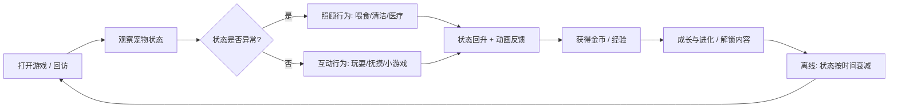

# CyberPet 游戏设计文档（GDD）

> **版本**：v0.1（设计草案）　**日期**：2026-11-26　**状态**：待评审
> **项目**：CyberPet — 赛博宠物主题微信小游戏
> **玩法参考**：拓麻歌子（Tamagotchi）养成核心 + 数码暴龙机进化分支 + QQ 宠物轻社交
> **阶段**：项目阶段一「完成小游戏项目的设计内容」

---

## 1. 产品概述

### 1.1 一句话定位

领养一只从蛋里孵化的赛博机械宠物，通过**照顾、互动、小游戏**让它成长进化，在碎片时间里获得「养电子宠物」的陪伴感与养成成就感。

### 1.2 玩法参考与取舍

| 参考原型 | 借鉴点 | 本作取舍 |
|---|---|---|
| 拓麻歌子 | 状态条衰减、喂食/清洁/玩耍三件套、随时查看 | 保留核心循环作为主玩法 |
| 数码暴龙机 | 成长阶段、条件分支进化 | 保留，但简化为 4 个阶段 + 4 种形态 |
| QQ 宠物 | 金币经济、道具商店、好友串门 | 保留轻量版，不做复杂装扮系统 |
| 旅行青蛙 | 离线也有收获、温和回报 | 借鉴「离线保底」，但不做旅行系统 |

### 1.3 目标用户

- **核心用户**：18–35 岁，有电子宠物/养成游戏怀旧情结的微信用户。
- **次级用户**：喜欢轻量化、无压力陪伴型游戏的休闲玩家。
- **场景**：通勤、排队、睡前等碎片时间，单次 1–3 分钟，每日回访 2–4 次。

### 1.4 设计目标与红线

| 目标 | 说明 |
|---|---|
| 3 秒上手 | 主界面一眼看懂宠物状态，按钮即点即反馈 |
| 无压力养成 | **不设死亡机制**，离线有保护期与保底，避免惩罚性流失 |
| 碎片化节奏 | 核心互动单次 < 10 秒，小游戏单局 30 秒 |
| 微信原生感 | 登录、分享、订阅消息与微信生态自然衔接 |

**红线**：不做内购（阶段一～三）、不做重度数值付费、不诱导过度授权、不使用未授权 IP 形象。

---

## 2. 核心玩法循环



**循环设计要点**

1. **回访动机**：状态衰减提供回访理由，但衰减速率温和且有保底（见 3.4）。
2. **操作闭环**：每次互动都有「属性变化 + 动画 + 音效 + 浮动数字」四重反馈。
3. **成长驱动**：经验与进化给长期目标，金币与商店给短期目标。

---

## 3. 宠物状态系统

### 3.1 属性定义

所有属性范围 0–100，主界面以 4 条状态条展示（健康以图标警示）。

| 属性 | 简称 | 初始值 | 作用 | 低于阈值的影响 |
|---|---|---|---|---|
| 饱食度 | Satiety | 70 | 随时间下降 | < 30 时健康缓慢下降 |
| 清洁度 | Hygiene | 70 | 随时间下降 | < 30 时健康缓慢下降，心情加速下降 |
| 心情 | Mood | 80 | 玩耍/抚摸提升 | < 30 时进化偏向废土形态 |
| 精力 | Energy | 80 | 玩耍消耗、睡眠恢复 | < 20 时无法进行小游戏 |
| 健康 | Health | 100 | 综合派生属性 | < 40 进入「虚弱」状态，需医疗 |

### 3.2 衰减模型

| 阶段 | 饱食/小时 | 清洁/小时 | 心情/小时 | 精力/小时 |
|---|---|---|---|---|
| 蛋（未孵化） | 0 | 0 | 0 | 0 |
| 幼体 | -4 | -3 | -3 | -2 |
| 成体 | -3 | -2 | -2 | -1.5 |
| 进化体 | -2.5 | -2 | -2 | -1.5 |
| 老年体 | -3 | -2.5 | -2.5 | -2 |

> 衰减按**真实时间**计算，登录时一次性结算，避免后台定时器耗电。

### 3.3 状态联动规则

- 每 10 分钟结算一次：若 `饱食 < 30 || 清洁 < 30`，健康 `-1`；若四项均 `>= 60`，健康 `+1`（上限 100）。
- 健康 < 40 时进入「虚弱」：宠物动画变慢、色调变灰，禁止小游戏，仅可喂食/医疗/休息。
- **无死亡机制**：健康最低保底 10，不会归零，避免用户流失与审核风险。

### 3.4 离线规则（关键）

| 离线时长 | 衰减系数 | 说明 |
|---|---|---|
| 0–4 小时 | 50% | 保护期，鼓励高频回访但不惩罚 |
| 4–12 小时 | 100% | 正常衰减 |
| > 12 小时 | 100%，但设保底 | 饱食 ≥ 20、健康 ≥ 30、精力 ≥ 30 |

> 设计意图：既保留「宠物需要照顾」的养成感，又避免隔夜回来发现宠物濒死导致的挫败感。

---

## 4. 生命周期与进化

### 4.1 阶段划分

| 阶段 | 时长（在线累计） | 解锁内容 | 视觉变化 |
|---|---|---|---|
| 蛋 Egg | 0–5 分钟 | 点击/摇晃孵化 | 蛋壳抖动、裂纹逐步出现 |
| 幼体 Baby | 5–30 分钟 | 基础喂食、抚摸 | 大头小身、动作笨拙 |
| 成体 Adult | 30–180 分钟 | 小游戏、商店 | 体型修长、动作流畅 |
| 进化体 Evolved | 180 分钟+ | 进化分支、高级道具 | 形态分化、专属光效 |
| 老年体 Senior | 480 分钟+ | 称号、纪念相册 | 色调偏暖、动作放缓 |

> 时长为 Demo 阶段默认值，用于快速验证流程；正式版可按「在线时长 + 互动次数」双条件调整。

### 4.2 进化分支（成体 → 进化体）

| 形态 | 条件 | 性格设定 |
|---|---|---|
| 光翼型（Azure） | 平均心情 ≥ 80 且清洁 ≥ 70 | 轻盈、爱玩耍 |
| 重装型（Bastion） | 平均饱食 ≥ 80 且健康 ≥ 90 | 沉稳、耐饿 |
| 均衡型（Core） | 四项属性平均 ≥ 70 但未达上述条件 | 万能、平衡 |
| 废土型（Rust） | 健康长期 < 50 或心情长期 < 40 | 隐藏形态，剧情彩蛋 |

> 进化时播放专属动画 + 解锁形态图鉴，强化成就感。

### 4.3 孵化流程

1. 首次进入 → 选择宠物名字（默认随机名，可改一次）。
2. 蛋阶段：点击蛋 5 次 / 长按摇晃 3 秒 → 破壳动画 → 幼体。
3. 孵化完成引导：弹出 3 步新手引导（喂食、清洁、玩耍），完成后赠送 50 金币。

---

## 5. 互动操作

### 5.1 主动互动

| 操作 | 条件 | 消耗 | 效果 | 反馈 |
|---|---|---|---|---|
| 普通粮 | 无 | 10 金币 | 饱食 +25 | 咀嚼动画 + 满意表情 |
| 能量块 | 成体+ | 30 金币 | 饱食 +40、精力 +10 | 充能光效 |
| 垃圾食品 | 无 | 5 金币 | 饱食 +30、健康 -5 | 得意表情（有代价） |
| 清洗 | 清洁 < 90 | 5 金币 | 清洁 +30 | 泡泡动画 |
| 抚摸 | 无 | 无 | 心情 +8（冷却 10 秒） | 蹭蹭动画 + 随机台词 |
| 睡眠 | 无 | 无 | 精力 +2/分钟 | 关闭灯光、Zzz 动画 |
| 医疗 | 健康 < 80 | 20 金币 | 健康 +30 | 十字光效 |

### 5.2 反馈设计原则

- **即时**：点击后 100ms 内出现动画反馈。
- **可见**：属性变化用浮动数字（`+25`）显示在状态条旁。
- **可听**：每种互动配 1 个短音效（< 1 秒，可静音）。
- **可感**：宠物有随机台词库（≥ 20 条），避免重复感。

---

## 6. 内置小游戏

| 游戏 | 玩法 | 时长 | 奖励 | 解锁 |
|---|---|---|---|---|
| 接数据块 | 左右移动接掉落的数据块，躲开病毒块 | 30 秒 | 金币 10–40，心情 +15 | 成体 |
| 能量奔跑 | 点击节奏跨越障碍，连续 Combo 加分 | 30 秒 | 金币 10–50，精力 -15 | 成体 |
| 记忆配对 | 翻开卡片配对赛博图标，全对通关 | 约 60 秒 | 金币 20，心情 +20 | 进化体 |

- 小游戏入口在主界面右下角，避免干扰主养成循环。
- 单局结束立刻结算，返回主界面并播放宠物庆祝动画。
- 每日小游戏金币上限 150，防止无限刷取破坏经济。

---

## 7. 经济与道具

### 7.1 金币来源

| 来源 | 数量 | 限制 |
|---|---|---|
| 照顾行为 | 每次 +5 | 每日上限 50 |
| 小游戏 | 10–50 / 局 | 每日上限 150 |
| 每日任务 | 100 | 每日一次 |
| 分享给好友 | 20 / 次 | 每日上限 40 |
| 好友串门 | 10 / 次 | 每日上限 30 |

### 7.2 商店

- **消耗品**：食物、医疗包、清洁剂。
- **装饰品**：背景、宠物配件（提供心情衰减 -5%~10% 被动加成）。
- **图鉴**：进化形态纪念卡（纯收藏，无数值）。

### 7.3 每日任务示例

| 任务 | 奖励 |
|---|---|
| 喂食 3 次 | 30 金币 |
| 完成 1 局小游戏 | 30 金币 |
| 抚摸宠物 5 次 | 20 金币 |
| 分享游戏 | 20 金币 |

---

## 8. 界面与交互

### 8.1 主界面布局（竖屏）

```
┌─────────────────────────┐
│ 宠物名 Lv.形态   [设置]  │  ← 顶部信息栏
│ 饱食 ██████░░ 70         │
│ 清洁 ███████░ 70         │  ← 4 条状态条
│ 心情 ████████ 80         │
│ 精力 ████████ 80         │
├─────────────────────────┤
│                         │
│      [ 宠物动画区 ]      │  ← 占屏 55%，点击有反馈
│                         │
├─────────────────────────┤
│ [喂食][清洁][玩耍][休息] │  ← 主操作按钮
│      [商店] [小游戏]     │  ← 次级入口
└─────────────────────────┘
```

### 8.2 视觉风格

- **主题**：轻赛博朋克 + 复古像素，避免过度炫酷导致小屏幕可读性下降。
- **配色**：深蓝底 `#0B1021`、霓虹青 `#00F0FF`、品红 `#FF2E88`、暖黄 `#FFD166`。
- **字体**：系统无衬线字体，数值与按钮文字不小于 14px。
- **动效**：宠物待机呼吸动画 + 状态异常时的抖动提示；避免高频闪烁。

### 8.3 关键交互

- 点击宠物：随机台词 + 心情 +2（冷却 10 秒）。
- 长按宠物：进入「抚摸」模式，连续触发 3 次爱心粒子。
- 状态条点击：弹出该属性的说明与恢复方式（降低理解成本）。
- 设置：音效开关、提醒设置、存档管理。

---

## 9. 微信生态接入

| 能力 | 接入方式 | 使用场景 | 备注 |
|---|---|---|---|
| 微信登录 | `wx.login` 静默登录 | 首次进入绑定 openid | 不强制授权用户信息 |
| 分享 | `onShareAppMessage` | 邀请好友、炫耀进化形态 | 分享图用宠物当前形态截图 |
| 分享到朋友圈 | `onShareTimeline` | 进化成就 | 阶段四接入 |
| 订阅消息 | `wx.requestSubscribeMessage` | 宠物状态提醒（每日一次） | **仅在用户主动点击提醒按钮时申请** |
| 好友串门 | 分享链接带 inviter 参数 | 双方得金币 | 服务端校验防止刷取 |
| 云开发 | 阶段六可选 | 存档云同步、排行榜、统计 | 主包体积敏感，按需分包 |

**合规注意**：订阅消息需用户明确授权，不得默认勾选；分享奖励不得诱导「必须分享」才能继续游戏。

---

## 10. 技术设计

### 10.1 技术选型

| 项 | 选择 | 理由 |
|---|---|---|
| 运行环境 | 微信小游戏（Canvas 2D + 原生 JS） | 宠物帧动画与小游戏需要流畅帧率，避免频繁 `setData` |
| 渲染 | Canvas 绘制 + 离屏缓存 | 60fps 稳定，减少主线程压力 |
| 状态管理 | 单例 Store + 本地 Storage | 轻量，无第三方依赖 |
| 后端 | 阶段一～三纯本地；阶段六接云开发 | 降低 Demo 阶段复杂度 |
| 分包 | 小游戏与图鉴放分包 | 主包控制在 1.5MB 以内 |

### 10.2 存档结构（草案）

```json
{
  "pet": {
    "name": "小电",
    "stage": "adult",
    "form": "core",
    "stats": { "satiety": 70, "hygiene": 70, "mood": 80, "energy": 80, "health": 100 },
    "exp": 120,
    "bornAt": 1764000000000,
    "onlineMinutes": 45
  },
  "player": { "coins": 350, "inventory": [], "decorations": [] },
  "meta": { "lastSettleAt": 1764000000000, "dailyTaskDate": "2026-11-26" }
}
```

### 10.3 性能预算

- 主包 < 1.5MB；帧序列图片压缩为 WebP，单帧 < 20KB。
- 首屏加载 < 1.5s（中端安卓机）；`setData` 调用仅在状态变更时触发。
- 离线衰减通过登录时一次结算，无后台定时器。

---

## 11. 开发阶段与验收

| 阶段 | 内容 | 本设计文档对应章节 | 状态 |
|---|---|---|---|
| 一 | 完成小游戏项目的设计内容 | 全文 | **进行中（本文档）** |
| 二 | 完成小游戏 demo 流程和测试 | 2/3/4/5/8 | 未开始 |
| 三 | 完成小游戏的完整流程和测试 | 6/7/9 | 未开始 |
| 四 | 完成小游戏对微信的对接内容 | 9/10 | 未开始 |
| 五 | 完成小游戏的内容测试 | 3/4（数值调优） | 未开始 |
| 六 | 完成后台统计数据接入 | 9/10.2 | 未开始 |

### 阶段一验收标准

- [ ] 本文档评审通过，核心循环与数值模型确认
- [ ] 宠物形态与进化分支确认，美术风格方向确认
- [ ] 小游戏数量与奖励区间确认
- [ ] 微信生态接入范围确认（尤其订阅消息与分享奖励）

---

## 12. 风险与对策

| 等级 | 风险 | 对策 |
|---|---|---|
| 🔴 高 | 离线衰减过猛导致隔日回访流失 | 保护期 + 保底机制（3.4），数值在阶段五实测调优 |
| 🔴 高 | 微信审核判定「诱导分享」 | 分享奖励非必需、不阻断流程，文案避免「必须分享」 |
| 🟡 中 | 订阅授权率低、提醒打扰 | 仅在玩家主动点击提醒时申请，每日最多 1 条 |
| 🟡 中 | 进化条件过难，玩家看不到分支 | Demo 阶段缩短时长，图鉴提示条件 |
| 🟡 中 | 主包超出 2MB 限制 | 帧序列压缩 + 小游戏分包，CI 检查包体 |
| 🟢 低 | 无内购导致变现空白 | 阶段一～三不考虑商业化，验证留存后再议 |

---

## 13. 待确认事项

以下为设计默认值，评审时可调整：

1. **进化时长**：当前按在线分钟计（180 分钟达进化体），是否改为「互动次数 + 在线时长」双条件？
2. **小游戏数量**：Demo 先做 1 个（接数据块）还是 3 个全做？
3. **宠物主题**：赛博机械宠物 vs. 更复古的像素生物？当前按赛博机械设计。
4. **存档**：阶段二是否直接上云开发存档，还是先本地 Storage？

---

## 附录 A：数值速查表

| 项 | 值 |
|---|---|
| 属性上限 | 100 |
| 饱食衰减（成体） | 3 / 小时 |
| 离线保护期 | 4 小时（衰减 ×0.5） |
| 离线保底线 | 饱食 20 / 健康 30 / 精力 30 |
| 进化体门槛 | 在线 180 分钟 |
| 小游戏金币上限 | 150 / 日 |
| 普通粮 | 10 金币 → 饱食 +25 |
| 医疗包 | 20 金币 → 健康 +30 |
| 主包上限 | 1.5 MB（目标） |
