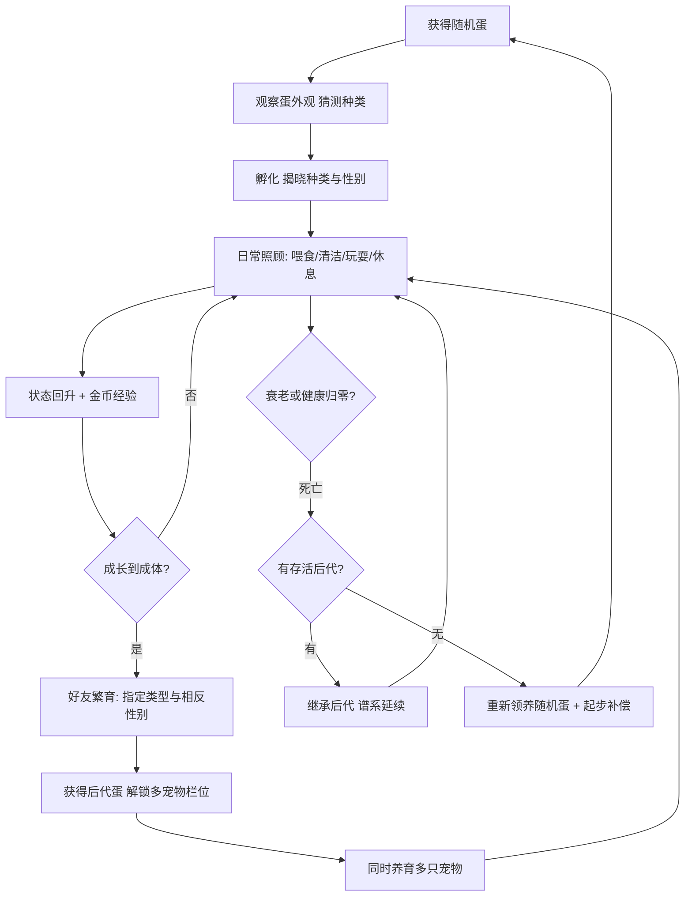

# CyberPet 游戏设计文档（GDD）

> **版本**：v0.2（按 2026-11-26 评审意见改写）　**日期**：2026-11-26　**状态**：待评审
> **项目**：CyberPet — 拟真史前动物主题微信小游戏
> **玩法参考**：拓麻歌子（Tamagotchi）养成核心 + 数码暴龙机成长分支 + QQ 宠物繁育社交
> **阶段**：项目阶段一「完成小游戏项目的设计内容」
>
> **v0.2 主要变更**：① 新增死亡与后代继承机制；② 新增性别与好友指定类型交配生子；③ 新增多宠物饲养与玩法解锁；④ 新增豢养记录（编年史 + 谱系）；⑤ 主题由赛博机械改为**拟真动物**，首版仅霸王龙、三角龙、蛇颈龙；⑥ 领养改为**随机蛋**，由蛋外观判断种类。

---

## 1. 产品概述

### 1.1 一句话定位

从一枚**外观暗藏玄机的恐龙蛋**开始，随机领养霸王龙、三角龙或蛇颈龙，通过照顾、互动与繁育延续血脉，在死亡与新生之间体验「养一只真实史前生物」的陪伴感与传承感。

### 1.2 玩法参考与取舍

| 参考原型 | 借鉴点 | 本作取舍 |
|---|---|---|
| 拓麻歌子 | 状态衰减、喂食/清洁/玩耍、随时查看 | 保留核心循环 |
| 数码暴龙机 | 成长阶段、条件分支 | 保留，改为体征分化而非赛博进化 |
| QQ 宠物 | 繁育、多宠、道具经济 | 保留并强化为「血脉传承」主线 |
| 真实饲养模拟 | 生老病死、谱系延续 | 本作差异化核心，但表现含蓄、审核友好 |

### 1.3 目标用户

- **核心用户**：18–35 岁，喜欢恐龙/史前生物，或有电子宠物怀旧情结的微信用户。
- **次级用户**：喜欢轻社交、繁育收集玩法的休闲玩家。
- **场景**：碎片时间单次 1–3 分钟；繁育、串门等社交行为需要好友协作。

### 1.4 设计目标与红线

| 目标 | 说明 |
|---|---|
| 3 秒上手 | 主界面一眼看懂当前宠物状态，按钮即点即反馈 |
| 有代价但可延续 | 宠物会死亡，但通过后代表与继承机制让血脉不断，避免归零挫败 |
| 随机惊喜 | 蛋不可选种类，靠外观辨认，孵化时揭晓性别 |
| 微信原生感 | 繁育邀请、分享、订阅消息与微信生态自然衔接 |

**红线**：不做内购（阶段一～三）、不使用未授权 IP 形象、死亡表现**不含血腥与恐怖元素**、繁育表现**含蓄不写实**、不诱导分享与过度授权。

---

## 2. 核心玩法循环



**循环设计要点**

1. **短循环**：照顾 → 反馈 → 金币经验，单次 < 10 秒。
2. **中循环**：成长 → 繁育 → 后代 → 多宠，形成 1–3 天的目标。
3. **长循环**：死亡 → 继承 → 豢养记录累积，形成跨周/跨月的收藏与传承。

---

## 3. 宠物种类、随机蛋与性别

### 3.1 首版种类（仅三种）

| 种类 | 学名 | 食性 | 栖息偏好 | 基础特性 |
|---|---|---|---|---|
| 霸王龙 | Tyrannosaurus | 肉食 | 陆地 / 丛林 | 攻击高、饱食衰减快 |
| 三角龙 | Triceratops | 植食 | 陆地 / 草原 | 防御高、心情衰减慢 |
| 蛇颈龙 | Plesiosaurus | 肉食 | 水域 | 精力恢复快、清洁衰减快 |

> 首版**只做这三种**，不做其他恐龙；后续种类通过版本更新追加。

### 3.2 随机蛋机制（核心特色）

- 玩家**无法选择**领养哪种恐龙；每次领养从蛋池随机抽取一枚蛋。
- **蛋外观是唯一线索**，玩家需凭外观判断种类，孵化时才正式揭晓。

| 蛋外观 | 对应种类 | 辨识要点 |
|---|---|---|
| 深红褐色、粗大椭圆、尖锐鳞纹、暗色斑块 | 霸王龙 | 「看起来很硬」→ 掠食者 |
| 土黄色、圆润、青灰条纹、盾牌状纹路 | 三角龙 | 「纹路像盾」→ 角龙 |
| 青蓝色、细长、水波纹、表面湿润光泽 | 蛇颈龙 | 「像水生」→ 水栖龙 |

- **观察蛋**：点击蛋可获得一句提示文案（如「外壳纹路锋利，似乎属于某种掠食者」），不给确定答案，保留猜测乐趣。
- **稀有度**：普通 80% / 稀有 15% / 珍藏 5%，影响孵化后的花纹与体型细节，**不影响种类概率**。

### 3.3 性别设定

- 每只宠物孵化时随机确定性别：雄性 ♂ 55% / 雌性 ♀ 45%（可配置）。
- 性别在**蛋阶段不可见**，与种类一同在孵化时揭晓。
- 性别影响：

| 维度 | 雄性 ♂ | 雌性 ♀ |
|---|---|---|
| 外观 | 体色更鲜艳、体型略大、角/冠更发达 | 体色柔和、线条圆润 |
| 繁育 | 可与雌性交配 | 可与雄性交配 |
| 数值 | 无差异（避免性别歧视争议） | 无差异 |

---

## 4. 状态系统与死亡机制

### 4.1 属性定义

所有属性范围 0–100，主界面展示 4 条状态条 + 健康图标。

| 属性 | 初始值 | 作用 | 低于阈值的影响 |
|---|---|---|---|
| 饱食度 Satiety | 70 | 随时间下降 | < 30 时健康缓慢下降 |
| 清洁度 Hygiene | 70 | 随时间下降 | < 30 时健康下降、心情加速下降 |
| 心情 Mood | 80 | 玩耍/互动提升 | < 30 时体征偏向「沧桑型」 |
| 精力 Energy | 80 | 玩耍/繁育消耗、睡眠恢复 | < 20 时禁止小游戏与繁育 |
| 健康 Health | 100 | 综合派生属性 | < 40 进入「虚弱」，低于阈值持续过久会死亡 |

### 4.2 衰减模型

| 阶段 | 饱食/小时 | 清洁/小时 | 心情/小时 | 精力/小时 |
|---|---|---|---|---|
| 蛋 | 0 | 0 | 0 | 0 |
| 幼体 | -4 | -3 | -3 | -2 |
| 成体 | -3 | -2 | -2 | -1.5 |
| 成熟体 | -2.5 | -2 | -2 | -1.5 |
| 老年体 | -3 | -2.5 | -2.5 | -2 |

> 按真实时间结算，登录时一次性计算，不用后台定时器。

### 4.3 离线规则

| 离线时长 | 衰减系数 | 说明 |
|---|---|---|
| 0–4 小时 | 50% | 保护期 |
| 4–12 小时 | 100% | 正常衰减 |
| > 12 小时 | 100%，设保底 | 饱食 ≥ 15、健康 ≥ 15、精力 ≥ 20 |

> 注意：v0.1 的「健康保底 30、永不死亡」已取消——保留离线保护期，但**不再阻断死亡机制**。

### 4.4 死亡机制（新增）

**触发条件（满足其一）**

1. **病变死亡**：健康跌至 0。健康 < 40 进入「虚弱」并开始计时，若连续 **12 小时**内未将健康恢复到 40 以上，则判定死亡（给玩家补救窗口）。
2. **自然衰老**：进入老年体后累计在线满 **240 分钟**，自然死亡。

**表现设计（审核友好）**

- 温和的告别动画：宠物安静趴下 → 画面渐暗 → 出现纪念卡（名字、种类、性别、寿命、一句话回忆）。
- **无血腥、无遗体、无噩梦式演出**；文案用「回归星海」「完成了生命旅程」等含蓄表达。
- 死亡后不弹付费复活，不做强制分享复活。

**死亡后处理（关键）**

| 情形 | 处理 |
|---|---|
| **有存活后代** | 弹出继承选择：从存活后代中指定一只作为新的主养宠物；父代档案标记「已故」，后代谱系记录父母；继承后保留全部金币与解锁进度 |
| **无后代** | 回到领养界面，赠送**一枚随机蛋 + 100 金币**起步补偿，避免玩家一无所有 |
| **多宠场景** | 仅当前养宠物死亡触发继承流程；其他宠物继续正常饲养 |

> 设计意图：让死亡有真实重量，但血脉与进度可延续，避免「删号式」惩罚。

---

## 5. 生命周期与成长

### 5.1 阶段划分

| 阶段 | 时长（在线累计） | 解锁内容 | 视觉变化 |
|---|---|---|---|
| 蛋 Egg | 0–5 分钟 | 观察、孵化 | 依种类呈现不同外观与抖动节奏 |
| 幼体 Baby | 5–30 分钟 | 基础喂食、抚摸 | 大头小身、动作笨拙 |
| 成体 Adult | 30–180 分钟 | 小游戏、商店、**繁育资格** | 体型修长、物种特征显现 |
| 成熟体 Mature | 180–480 分钟 | 高级道具、繁育强化 | 体征分化、性别特征明显 |
| 老年体 Senior | 480 分钟+ | 纪念相册 | 动作放缓、色调偏暖；满 240 分钟后自然死亡 |

### 5.2 体征分化（成熟体）

依据长期照顾方式产生外观差异，替代 v0.1 的赛博形态分支：

| 体征 | 条件 | 外观 |
|---|---|---|
| 强壮型 | 平均饱食 ≥ 80 且健康 ≥ 90 | 体型更大、体色深、肌肉线条明显 |
| 敏捷型 | 平均心情 ≥ 80 且精力 ≥ 75 | 体态轻盈、体色亮、动作迅捷 |
| 标准型 | 四项平均 ≥ 70 但未达上述条件 | 物种标准外观 |
| 沧桑型 | 健康长期 < 50 或心情长期 < 40 | 体色暗淡、有伤痕花纹 |

### 5.3 孵化流程

1. 进入领养界面 → 随机获得一枚蛋（外观暗示种类）。
2. 观察蛋：获得提示文案，玩家猜测种类。
3. 孵化：点击 5 次 / 长按摇晃 3 秒 → 破壳动画 → **同时揭晓种类与性别**。
4. 新手引导：喂食、清洁、玩耍三步，完成赠送 50 金币。
5. 首次孵化结果自动记入豢养记录。

---

## 6. 互动操作

| 操作 | 条件 | 消耗 | 效果 | 反馈 |
|---|---|---|---|---|
| 肉类（霸王龙/蛇颈龙偏好） | 无 | 10 金币 | 饱食 +25 | 咀嚼 + 满意动画 |
| 植食（三角龙偏好） | 无 | 8 金币 | 饱食 +22、心情 +5 | 啃食动画 |
| 营养餐 | 成体+ | 30 金币 | 饱食 +40、精力 +10 | 活力光效 |
| 泥浴清洁 | 清洁 < 90 | 5 金币 | 清洁 +30 | 泡泡动画 |
| 抚摸 | 无 | 无 | 心情 +8（冷却 10 秒） | 蹭蹭 + 随机叫声字幕 |
| 休息 | 无 | 无 | 精力 +2/分钟 | 闭眼、呼吸动画 |
| 药草治疗 | 健康 < 80 | 20 金币 | 健康 +30 | 温和治愈光效 |

**偏好加成**：投喂偏好食物时额外 +5 心情，鼓励记住每种恐龙的食性。

**反馈原则**：点击后 100ms 内动画响应；属性变化用浮动数字；每种互动配 1 个短音效（可静音）；宠物有 ≥ 20 条随机叫声字幕。

---

## 7. 繁育与多宠物饲养（新增）

### 7.1 繁育条件

- 双方宠物均为**成体及以上**，健康 ≥ 60，精力 ≥ 50。
- 双方性别必须**相反**（♂ × ♀）。
- 发起方消耗 50 金币；每只宠物每日繁育上限 1 次，玩家每日上限 2 次。

### 7.2 繁育流程（好友指定类型）

1. 发起方进入「繁育」界面，选择自己的宠物。
2. **指定对方宠物的种类**（霸王龙 / 三角龙 / 蛇颈龙）与**性别**（必须与自己宠物相反）。
3. 生成繁育邀请，通过微信分享发送给好友（附宠物与指定条件说明）。
4. 好友打开链接，使用**符合条件的宠物**接受邀请；不符合时提示「你需要一只 XX 性的 XX 龙」。
5. 双方确认后结算：双方宠物各消耗精力 30，发起方扣 50 金币。
6. 产出 **1–3 枚后代蛋**，归发起方所有；好友获得 30 金币 + 亲缘值。

### 7.3 后代规则

| 情形 | 后代 |
|---|---|
| 同种交配（如 ♂霸王龙 × ♀霸王龙） | 纯种后代，种类与父母相同 |
| 跨类型交配（如 ♂霸王龙 × ♀三角龙） | **混种后代**（稀有），种类随机继承一方，外观融合双亲特征，图鉴单独收录 |
| 性别 | 随机 ♂/♀，孵化时揭晓 |
| 蛋外观 | 融合双亲蛋外观特征，仍需猜蛋 |

> 混种是收集向亮点，但需在美术上保持拟真可信，避免「四不像」。

### 7.4 多宠物栏位与玩法解锁

| 同时养育数 | 解锁条件 | 解锁玩法 |
|---|---|---|
| 1 | 初始 | 基础养成 |
| 3 | 首次繁育成功 | 宠物间互动（一起玩耍，心情 +）、批量照料 |
| 4 | 累计后代达 3 只 | **恐龙竞技场**（属性比拼，每日 3 场） |
| 5 | 累计后代达 5 只 | 家族任务（多宠协作，奖励稀有道具） |
| 6（上限） | 累计后代达 8 只 | 「图鉴大师」称号与专属栖息地背景 |

- 主界面提供宠物列表与左右滑动切换，状态栏随当前宠物切换。
- 每只宠物独立结算状态与年龄；离线衰减按各自所属阶段计算。

### 7.5 好友匹配

- 阶段二：仅通过微信分享链接邀请好友。
- 阶段三：增加「匹配大厅」，无好友时可发布繁育需求，由系统推荐符合条件的玩家（服务端校验，阶段四接入云开发后实现）。

---

## 8. 豢养记录（新增）

每只宠物从蛋到死亡（或存活）全程留档，形成玩家的私人「恐龙编年史」。

### 8.1 单宠档案

| 字段 | 内容 |
|---|---|
| 基础 | 名字、种类、性别、稀有度、蛋来源（随机/繁育/补偿） |
| 时间线 | 获得蛋、孵化、进入各成长阶段、体征分化、繁育事件、死亡时间与原因 |
| 关系 | 父母（如有）、配偶、后代列表 |
| 结局 | 存活 / 已故；寿命（在线时长 + 自然日） |
| 纪念 | 纪念卡、代表截图、一句话回忆（玩家可编辑） |

### 8.2 全局记录

- **编年史**：按时间轴展示所有养过的宠物（含已故），可点进单宠档案。
- **谱系图**：以家族树形式展示父母—后代关系，支持跨代追溯。
- **统计面板**：累计养育数、后代总数、最长寿宠物、种类收集进度、繁育次数。
- **图鉴**：三种恐龙 + 混种的标准形态、体征差异、性别差异，收集进度可视化。

### 8.3 数据持久化

- 阶段一～三：本地 Storage 保存，记录不可删除（避免误操作丢失传承）。
- 阶段六：接入云开发后支持跨设备同步，换机不丢豢养史。

---

## 9. 内置小游戏

| 游戏 | 玩法 | 时长 | 奖励 | 解锁 |
|---|---|---|---|---|
| 捕食训练 | 左右移动接猎物，避开毒刺与落石 | 30 秒 | 金币 10–40，心情 +15 | 成体 |
| 旷野奔跑 | 点击节奏跨越障碍，Combo 加分 | 30 秒 | 金币 10–50，精力 -15 | 成体 |
| 化石拼图 | 翻开卡片配对化石图案，全对通关 | 约 60 秒 | 金币 20，心情 +20 | 成熟体 |

- 每日小游戏金币上限 150；竞技场（7.4）另计。
- 小游戏表现保持拟真风格，避免像素/赛博元素。

---

## 10. 经济与道具

### 10.1 金币来源

| 来源 | 数量 | 限制 |
|---|---|---|
| 照顾行为 | 每次 +5 | 每日上限 50 |
| 小游戏 | 10–50 / 局 | 每日上限 150 |
| 每日任务 | 100 | 每日一次 |
| 繁育成功（接受方） | 30 | 每日上限 60 |
| 好友串门 | 10 / 次 | 每日上限 30 |
| 死亡补偿 | 100 | 仅无后代时发放 |

### 10.2 商店

- **食物**：肉类、植食、营养餐。
- **护理**：泥浴、药草治疗。
- **栖息地**：丛林、草原、水域背景（对应三种恐龙偏好，提供心情衰减加成）。
- **纪念品**：纪念卡边框、图鉴装裱（纯收藏）。

### 10.3 每日任务示例

喂食 3 次（30）、完成 1 局小游戏（30）、抚摸 5 次（20）、拜访好友（20）。

---

## 11. 界面与交互

### 11.1 主界面布局（竖屏）

```
┌──────────────────────────┐
│ [宠物1][宠物2][+]  [设置] │ ← 宠物切换栏 / 新增领养
│ 名字 种类 性别♂ Lv.形态    │
│ 饱食 ██████░░ 70          │
│ 清洁 ███████░ 70          │ ← 当前宠物状态条
│ 心情 ████████ 80          │
│ 精力 ████████ 80   ❤100   │
├──────────────────────────┤
│                          │
│      [ 恐龙动画区 ]       │ ← 占屏 50%，点击有互动反馈
│                          │
├──────────────────────────┤
│ [喂食][清洁][玩耍][休息]  │ ← 主操作
│ [繁育][记录][商店][游戏]  │ ← 次级入口
└──────────────────────────┘
```

### 11.2 视觉风格

- **主题**：拟真史前生物 + 手绘质感，避免 Q 版过度卡通，也避免过于写实的恐怖感。
- **配色**：自然色系——丛林绿 `#3E6B4F`、泥土棕 `#8B6B4A`、水域蓝 `#4A7C9B`、暖阳黄 `#E8C87A`。
- **字体**：系统无衬线，正文不小于 14px；蛋辨识要点用高对比描边。
- **动效**：待机呼吸动画、状态异常时轻微焦躁抖动；死亡演出温和、无闪烁。

### 11.3 关键交互

- 点击宠物：随机叫声字幕 + 心情 +2（冷却 10 秒）。
- 长按宠物：抚摸模式，爱心粒子。
- 点击状态条：说明该属性与恢复方式。
- 点击蛋：显示辨识提示文案，不剧透种类。
- 繁育入口：仅成体以上可见，未解锁时显示条件提示。

---

## 12. 微信生态接入

| 能力 | 接入方式 | 使用场景 | 备注 |
|---|---|---|---|
| 微信登录 | `wx.login` 静默登录 | 绑定 openid | 不强制授权用户信息 |
| 繁育邀请 | `onShareAppMessage` + 参数 | 指定种类与性别的繁育请求 | 分享卡展示发起方宠物与需求 |
| 好友串门 | 分享链接带 inviter | 双方得金币 | 服务端校验防刷 |
| 分享朋友圈 | `onShareTimeline` | 后代诞生、图鉴收集成就 | 阶段四接入 |
| 订阅消息 | `wx.requestSubscribeMessage` | 宠物虚弱提醒、繁育邀请到达 | **仅用户主动点击时申请**，每日最多 1 条 |
| 云开发 | 阶段六 | 繁育匹配、存档云同步、统计 | 服务端校验繁育条件，防作弊 |
| 匹配大厅 | 阶段三 | 无好友时的繁育匹配 | 依赖云开发 |

**合规注意**：繁育与死亡表现含蓄；分享奖励非必需、不阻断流程；订阅消息需明确授权。

---

## 13. 技术设计

### 13.1 技术选型

| 项 | 选择 | 理由 |
|---|---|---|
| 运行环境 | 微信小游戏（Canvas 2D + 原生 JS） | 多种宠物帧动画与竞技场需要帧率稳定 |
| 渲染 | Canvas + 离屏缓存，仅渲染当前宠物 | 多宠场景避免同屏重绘压力 |
| 状态管理 | 单例 Store + 本地 Storage | 轻量、无第三方依赖 |
| 后端 | 阶段一～三纯本地；阶段四起云开发 | 繁育校验与存档同步需要服务端 |
| 分包 | 小游戏、图鉴、繁育模块分包 | 主包目标 < 1.5MB |

### 13.2 存档结构（草案）

```json
{
  "player": { "coins": 350, "inventory": [], "unlockedSlots": 3, "kinship": 20 },
  "pets": [{
    "id": "pet_001",
    "name": "小斑",
    "species": "trex",
    "gender": "male",
    "rarity": "rare",
    "stage": "adult",
    "form": "strong",
    "stats": { "satiety": 70, "hygiene": 70, "mood": 80, "energy": 80, "health": 100 },
    "bornAt": 1764000000000,
    "onlineMinutes": 45,
    "parents": [],
    "offspring": ["pet_003"],
    "alive": true,
    "deathAt": null,
    "deathReason": null
  }],
  "activePetId": "pet_001",
  "eggs": [{ "id": "egg_002", "appearance": "red_scale", "source": "breeding" }],
  "records": [],
  "encyclopedia": { "trex": true, "triceratops": false, "plesiosaurus": false, "hybrid": [] },
  "meta": { "lastSettleAt": 1764000000000, "dailyTaskDate": "2026-11-26", "breedCountToday": 0 }
}
```

- `records` 为豢养日志数组：每条含 `petId`、`event`、`timestamp`、`detail`。
- 繁育请求与匹配结果单独存 `breedingLogs`，服务端留存副本防作弊。

### 13.3 性能预算

- 主包 < 1.5MB；帧序列 WebP 压缩，单帧 < 20KB。
- 首屏加载 < 1.5s（中端安卓机）；只渲染当前宠物，非活跃宠物仅更新数据。
- 离线衰减登录时一次结算；多宠最多 6 只，结算批量处理。

---

## 14. 开发阶段与验收

| 阶段 | 内容 | 对应章节 | 状态 |
|---|---|---|---|
| 一 | 完成设计内容 | 全文 | **进行中（本文档 v0.2）** |
| 二 | Demo 流程与测试：随机蛋、孵化、基础照顾、死亡与继承 | 3/4/5/6/11 | 未开始 |
| 三 | 完整流程：繁育、多宠、豢养记录、小游戏、竞技场 | 7/8/9/10 | 未开始 |
| 四 | 微信对接：登录、繁育邀请、订阅消息、云开发 | 12/13 | 未开始 |
| 五 | 内容测试：衰减与死亡数值调优、多机型 | 4/5 | 未开始 |
| 六 | 后台统计：留存、繁育转化、豢养时长 | 12/13.2 | 未开始 |

### 阶段一验收标准

- [x] 死亡与后代继承机制明确
- [x] 性别与好友指定类型繁育规则明确
- [x] 多宠物栏位与玩法解锁明确
- [x] 豢养记录（档案/编年史/谱系）明确
- [x] 三种拟真恐龙 + 随机蛋外观判断明确
- [ ] 死亡判定窗口（12 小时）与衰老时长数值确认
- [ ] 跨类型混种是否保留确认
- [ ] Demo 范围与美术资源量确认

---

## 15. 风险与对策

| 等级 | 风险 | 对策 |
|---|---|---|
| 🔴 高 | 宠物死亡造成玩家流失 | 温和演出 + 后代继承 + 无后代补偿蛋；死亡判定给 12 小时补救窗口 |
| 🔴 高 | 繁育邀请匹配不到好友，玩法卡死 | 阶段三匹配大厅兜底；发起时提示所需种类与性别 |
| 🔴 高 | 死亡/繁育表现触碰审核红线 | 无血腥、无写实繁殖、含蓄文案；评审前做合规自查 |
| 🟡 中 | 拟真恐龙美术资源量大、包体超限 | 三种恐龙共用骨骼/动作框架，帧序列压缩，分包加载 |
| 🟡 中 | 跨类型混种拟真度争议 | 美术上取双亲特征融合；若评审不通过则移除混种，仅保留同种繁育 |
| 🟡 中 | 多宠状态结算性能 | 只渲染当前宠物；离线结算批量处理；栏位上限 6 |
| 🟢 低 | 无内购导致变现空白 | 阶段一～三不商业化，先验证繁育与留存数据 |

---

## 16. 待确认事项

1. **死亡判定窗口**：虚弱持续 12 小时死亡、老年体 240 分钟自然死亡，数值是否合适？
2. **跨类型混种**：保留（趣味性）还是移除（拟真度）？
3. **Demo 范围**：阶段二是否三种恐龙全做，还是先做霸王龙 + 三角龙验证流程？
4. **繁育优先级**：阶段二只做好友邀请，还是同期做匹配大厅？
5. **蛋稀有度**：普通/稀有/珍藏三档是否保留？会不会让「猜蛋」变得过于复杂？

---

## 附录 A：数值速查表

| 项 | 值 |
|---|---|
| 属性上限 | 100 |
| 饱食衰减（成体） | 3 / 小时 |
| 离线保护期 | 4 小时（衰减 ×0.5） |
| 离线保底 | 饱食 15 / 健康 15 / 精力 20 |
| 虚弱判定 | 健康 < 40 |
| 病变死亡 | 虚弱持续 12 小时未恢复 |
| 衰老死亡 | 老年体累计在线 240 分钟 |
| 繁育条件 | 成体+、健康 ≥ 60、精力 ≥ 50、性别相反 |
| 繁育消耗 | 发起方 50 金币，双方精力 -30 |
| 后代数量 | 1–3 枚蛋 |
| 每日繁育上限 | 每宠 1 次 / 玩家 2 次 |
| 栏位上限 | 6 只 |
| 雄性概率 | 55% |
| 蛋稀有度 | 普通 80% / 稀有 15% / 珍藏 5% |
| 主包上限 | 1.5 MB（目标） |

## 附录 B：蛋外观速查

| 种类 | 颜色 | 形状 | 纹理 |
|---|---|---|---|
| 霸王龙 | 深红褐 | 粗大椭圆 | 尖锐鳞纹 + 暗斑 |
| 三角龙 | 土黄 | 圆润 | 青灰条纹 + 盾牌纹 |
| 蛇颈龙 | 青蓝 | 细长 | 水波纹 + 湿润光泽 |
